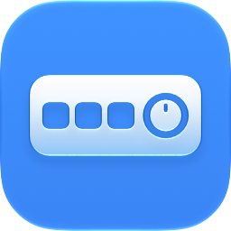
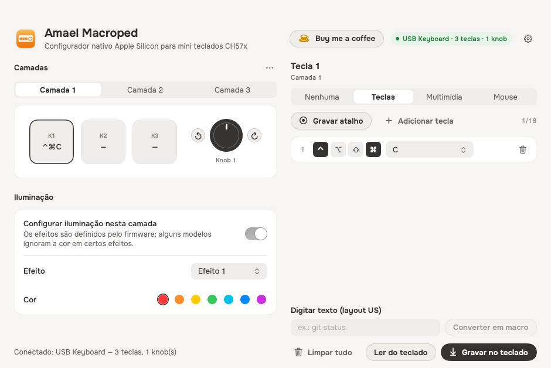
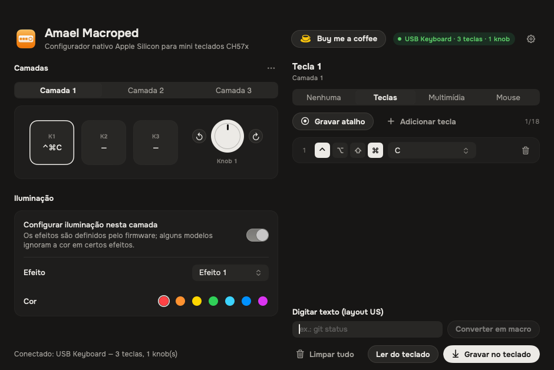

<p align="center"></p>

# Amael Macroped

**Configurador nativo para Apple Silicon (arm64) dos mini teclados/macropads USB baseados em CH57x** — os
modelos genéricos de 1 a 15 teclas com knob(s) rotativos vendidos como *"Mini Keyboard"*, *"Macro Pad"*,
*"Macroped"* etc., que acompanham o utilitário `MINI_KEYBOARD.app` (Intel/x86, exige Rosetta).

Como a Apple anunciou o fim do Rosetta 2 para apps Intel no macOS 28, este projeto substitui o utilitário
original por um app 100% nativo, sem dependências externas (SwiftUI + IOKit HID), com código aberto sob licença MIT.

| Claro | Escuro |
|---|---|
|  |  |

> 🇺🇸 **English summary** — Native Apple Silicon configurator for CH57x-based USB macro pads
> (VID `0x1189`, PIDs `0x8840/0x8842/0x883x/0x885x`). Replaces the vendor's Intel-only `MINI_KEYBOARD.app`.
> Program key shortcuts, macros, media keys, mouse actions and LED effects on 3 layers. GUI (pt-BR, English, Русский, 简体中文) + CLI, MIT licensed.
> The wire protocol is documented in [docs/PROTOCOL.md](docs/PROTOCOL.md).

## Recursos

- ✅ App nativo **arm64** (Apple Silicon) — não precisa de Rosetta; opcionalmente universal (arm64 + x86_64)
- ⌨️ Atalhos e **macros** de até 18 teclas (com ⌃ ⌥ ⇧ ⌘), gravação de atalho pelo teclado e conversão de texto em macro
- 🔊 Teclas **multimídia** (volume, mudo, play/pause, faixa, brilho, calculadora…)
- 🖱️ Ações de **mouse** (cliques, rolagem, ⌃/⇧/⌥ + rolagem para zoom e rolagem horizontal)
- 🎛️ **Knob**: girar à esquerda, pressionar e girar à direita — cada um com sua ação
- 🗂️ **3 camadas** independentes, cada uma com seu efeito/cor de **LED**
- 💾 Perfis em JSON (abrir/salvar) e restauração do último perfil automaticamente
- 🧹 Botão **Limpar tudo** (com confirmação) que zera as ações das 3 camadas no teclado
- 🖼️ Ícone do Icon Composer com os estilos do macOS: Padrão, Tom escuro, Translúcido e Tonalizado
- 🎨 Visual no design system do [Purge](https://github.com/jithin-sabu/purge-app) (fonte Onest, neutros grafite), com aparência Automático/Claro/Escuro
- 🌐 Interface em **Português (Brasil), English, Русский e 简体中文** — troca instantânea em *Ajustes* (⌘,)
- 🧰 **CLI** `macroped` para automação e diagnóstico
- 🔌 Detecção automática do layout (nº de teclas/knobs) informado pelo firmware

## Dispositivos compatíveis

| Vendor ID | Product IDs |
|-----------|-------------|
| `0x1189`, `0x514C` | `0x8840`, `0x8842`, `0x8830`, `0x8831`, `0x8832`, `0x8833`, `0x8850`, `0x8851` |

**Testado em hardware real:** `514C:8851` — 3 teclas + 1 knob (gravação, leitura, macro, mídia, mouse e LED verificados).

Para descobrir o seu: `ioreg -p IOUSB -l -w0 | grep -E 'idVendor|idProduct|USB Product Name'`
(`4489` = `0x1189`). Se o seu modelo usa outro PID com o mesmo protocolo, abra uma *issue*.

## Instalação

### Download

Baixe `AmaelMacroped-x.y.z.zip` em **Releases**, descompacte e mova **Amael Macroped.app** para `/Aplicativos`.

O app é assinado *ad-hoc* (sem certificado pago da Apple). Na primeira execução, clique com o botão direito ›
**Abrir**, ou remova a quarentena:

```bash
xattr -dr com.apple.quarantine "/Applications/Amael Macroped.app"
```

### Compilando o código-fonte

Requisitos: macOS 13+ e Xcode (ou Command Line Tools) com Swift 5.10+.

```bash
git clone https://github.com/amondf/amael-macroped.git
cd amael-macroped
swift test                       # testes do protocolo
scripts/build-app.sh             # gera dist/Amael Macroped.app (arm64)
scripts/build-app.sh --universal # arm64 + x86_64
```

## Uso

1. Conecte o mini teclado com um **cabo USB de dados** (cabos só de carga acendem o LED mas não enumeram o dispositivo).
   No macOS 15+, aceite o aviso *"Permitir que o acessório se conecte?"*.
2. Abra o **Amael Macroped** — o indicador fica verde quando o teclado é encontrado.
3. Escolha a **camada**, clique numa tecla ou numa direção do knob e defina a ação.
4. Clique em **Gravar no teclado** (⌘↩). A configuração fica salva na memória do próprio dispositivo
   e funciona em qualquer computador, sem o app aberto.

> **Camadas:** a troca de camada é feita pelo firmware do dispositivo (normalmente por uma combinação/botão
> específico do modelo). Se o seu modelo não troca camadas, use apenas a Camada 1.

### CLI

O executável `macroped` está dentro do app (`Amael Macroped.app/Contents/MacOS/macroped`) ou em `.build/release/macroped`.

```bash
macroped list                 # interfaces HID encontradas
macroped identify             # nº de teclas/knobs informado pelo firmware
macroped example > meu.json   # perfil de exemplo (edite à vontade)
macroped write meu.json       # grava o perfil
macroped read                 # lê a configuração (se o firmware suportar)
macroped monitor 10           # mostra relatórios HID recebidos (diagnóstico)
```

Exemplo de perfil (`macroped example`):

```json
{
  "name": "Padrão",
  "layout": { "keys": 3, "knobs": 1 },
  "layers": [
    {
      "bindings": [
        { "slot": "K1", "action": { "keys": [ { "modifiers": 8, "keyCode": 6 } ] } },
        { "slot": "K2", "action": { "mouse": "middleClick" } },
        { "slot": "knob1.left",  "action": { "media": "volumeDown" } },
        { "slot": "knob1.press", "action": { "media": "mute" } },
        { "slot": "knob1.right", "action": { "media": "volumeUp" } }
      ],
      "led": { "mode": 1, "color": 2 }
    },
    { "bindings": [] },
    { "bindings": [] }
  ]
}
```

* `slot`: `K1`…`K15`, `knobN.left`, `knobN.press`, `knobN.right`
* `keys`: lista de acordes; `modifiers` é a soma de 1 ⌃, 2 ⇧, 4 ⌥, 8 ⌘ (16/32/64/128 = lado direito);
  `keyCode` é o *HID usage* (ex.: 4 = A, 6 = C, 40 = Return, 58 = F1)
* `media`: `playPause`, `nextTrack`, `previousTrack`, `mute`, `volumeUp`, `volumeDown`, `brightnessUp`, …
* `mouse`: `leftClick`, `rightClick`, `middleClick`, `wheelUp`, `wheelDown`, `controlWheelUp`, `shiftWheelDown`, …
* `led.mode`: 0–5 · `led.color`: 1 vermelho, 2 laranja, 3 amarelo, 4 verde, 5 ciano, 6 azul, 7 roxo

## Solução de problemas

| Sintoma | Causa provável |
|---------|----------------|
| LED aceso, mas app "Desconectado" | Cabo só de carga, hub sem dados, ou acessório não autorizado em *Ajustes › Privacidade e Segurança*. Teste outro cabo/porta. |
| "O macOS negou acesso ao dispositivo" | Libere o app em *Ajustes › Privacidade e Segurança › Monitoramento de Entrada*. |
| Gravou, mas a tecla não faz nada | Confira se está na camada ativa do dispositivo; reconecte o teclado após gravar. |
| Atalho com ⌘ sai como Ctrl | No macOS o modificador "Win/GUI" do HID é o ⌘ — use o botão ⌘. |

## Como funciona

O protocolo foi documentado por engenharia reversa do utilitário original para fins de interoperabilidade —
veja [docs/PROTOCOL.md](docs/PROTOCOL.md). Em resumo: relatórios HID de saída de 65 bytes (Report ID `0x03`),
um registro de 50 bytes por tecla/direção do knob e um comando de confirmação `FD FE FF` por camada.

Estrutura do código:

```
Sources/MacropedKit/    protocolo, modelo de perfil, tabela de teclas e acesso HID (IOKit)
Sources/AmaelMacroped/  app SwiftUI (traduções em Localization/Strings+<Idioma>.swift)
Sources/MacropedCLI/    CLI "macroped"
Tests/MacropedKitTests/ testes do codificador/decodificador
```

**Novo idioma?** Copie `Sources/AmaelMacroped/Localization/Strings+English.swift`, traduza e adicione o caso em
`AppLanguage` — se faltar algum texto, o compilador avisa.

Agradecimentos ao projeto [ch57x-keyboard-tool](https://github.com/kriomant/ch57x-keyboard-tool), que também
documentou esta família de dispositivos.

## ☕ Apoie o projeto

Se o Amael Macroped te ajudou, considere pagar um café — o botão **Buy me a coffee** no app leva ao mesmo link:

**[☕ Buy me a coffee (Wise)](https://wise.com/pay/me/amona9)**

## Licença

[MIT](LICENSE). O design system é adaptado do Purge (MIT) e a fonte Onest é distribuída sob a SIL OFL 1.1 — veja [THIRD_PARTY_NOTICES.md](THIRD_PARTY_NOTICES.md). Este projeto não é afiliado ao fabricante do dispositivo nem distribui o software original.
